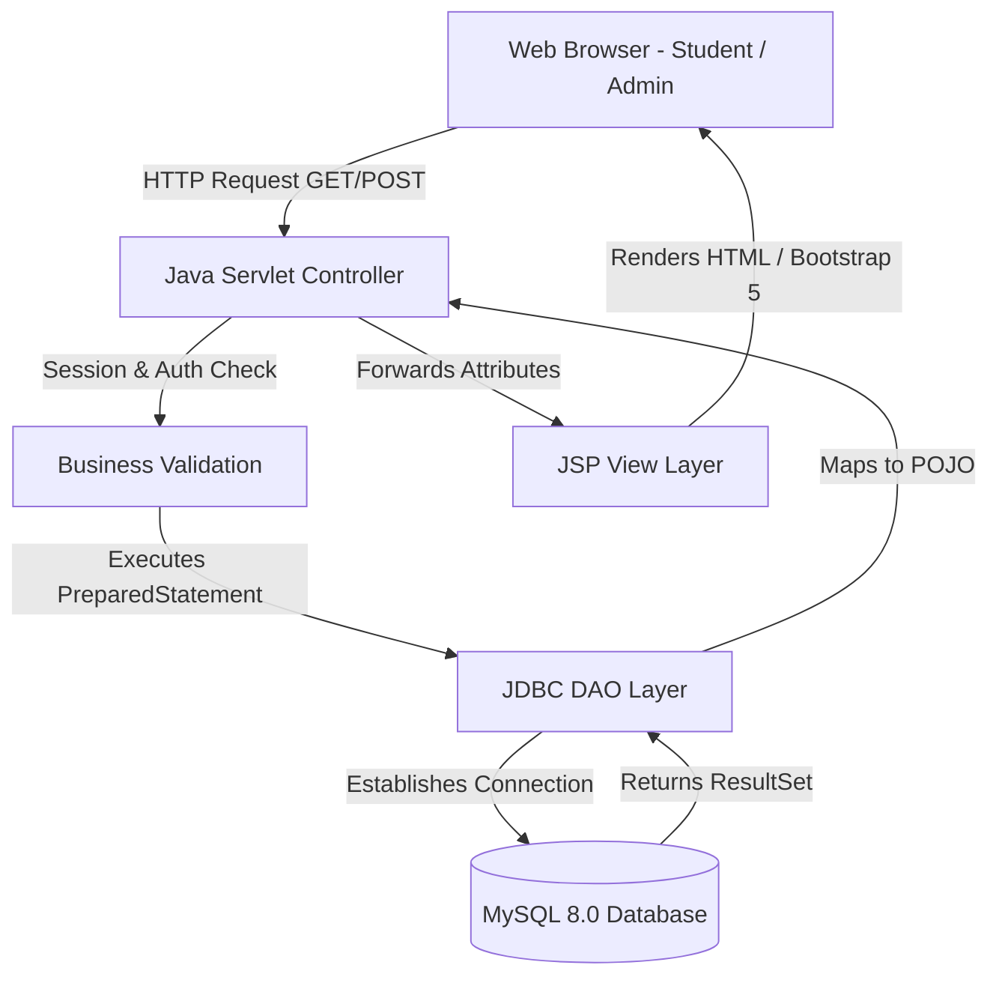

# PROJECT DOCUMENTATION
## CampusConnect – College Event Management System

**Academic Project Submission:** Advanced Java Web Technology Practical Submission  
**Degree / Course:** B.Tech Computer Science & Engineering  
**Technology Stack:** Java Servlets, JSP, JDBC, MySQL 8.0, HTML5, CSS3, Bootstrap 5  

---

### 1. Abstract
CampusConnect is an automated, web-based College Event Management System engineered to digitize event announcements, registrations, and administrative control in educational institutions. Built strictly using core Advanced Java technologies—**Java Servlets**, **JSP**, **JDBC**, and **MySQL**—it presents a clean Model-View-Controller (MVC) architecture. Students can browse, search, and register for campus events, while administrators manage events through full Create, Read, Update, Delete (CRUD) database operations.

---

### 2. Introduction
In traditional college environments, event management relies on physical notice boards, paper registration forms, and manual spreadsheet entries. This leads to information delays, duplicate entries, data loss, and inefficient capacity tracking. CampusConnect solves these challenges by providing a real-time web portal accessible by students and administration.

---

### 3. Problem Statement & Objectives
#### Problem Statement
Existing manual systems lack real-time visibility, automated duplicate registration prevention, seat capacity tracking, and centralized reporting for institute administrators.

#### Objectives
1. Build a robust web application using **Java Servlets**, **JSP**, **JDBC**, and **MySQL**.
2. Implement **Role-Based Access Control (RBAC)** for Students and Administrators.
3. Provide full **CRUD operations** for event management connected directly to MySQL.
4. Prevent duplicate student registrations for the same event.
5. Provide real-time calculated statistics on student participation and event capacity.

---

### 4. Technology Stack Justification
- **JSP (JavaServer Pages):** Provides dynamic HTML view rendering using tag libraries (JSTL) and Expression Language (EL).
- **Java Servlets:** Acts as the controller layer processing HTTP requests, enforcing session validation, and orchestrating business logic.
- **JDBC (Java Database Connectivity):** Facilitates safe, parameterized database interactions via `PreparedStatement` to prevent SQL injection vulnerabilities.
- **MySQL 8.0:** Provides relational data persistence with foreign key integrity and unique constraints.

---

### 5. System Architecture



---

### 6. Database ER Diagram & Schema Design

#### Entities & Relationships
1. **STUDENT (1) ------- (N) REGISTRATION**
   - A student can register for multiple events.
2. **EVENT (1) ------- (N) REGISTRATION**
   - An event can have multiple student registrations.

```
+-------------------+       +-----------------------+       +-------------------+
|      STUDENTS     |       |     REGISTRATIONS     |       |       EVENTS      |
+-------------------+       +-----------------------+       +-------------------+
| PK student_id     |<------| PK registration_id    |------>| PK event_id       |
|    name           |       | FK student_id         |       |    event_name     |
| UK email          |       | FK event_id           |       |    description    |
|    password       |       |    registration_date  |       |    category       |
| UK enrollment_no  |       |    status             |       |    venue          |
|    department     |       +-----------------------+       |    event_date     |
|    semester       |                                       |    event_time     |
+-------------------+                                       |    organizer      |
                                                            |    max_participants|
                                                            |    status         |
                                                            +-------------------+
```

---

### 7. Core Modules Description

#### Module 1: Home Page & Public Portal
- Displays landing page hero section, featured upcoming events, category breakdown, and live database statistics.

#### Module 2: Student Authentication & Registration
- Allows new students to sign up with email, password, department, semester, and enrollment number. Validates uniqueness before inserting into MySQL.

#### Module 3: Student Dashboard & Event Registration
- Displays active registrations and available events. Prevents duplicate registrations and enforces maximum seat capacity constraints.

#### Module 4: Admin Control Panel & Event CRUD
- Provides administrator login (`admin` / `admin123`).
- **CREATE:** Add new event form (`add-event.jsp` -> `AddEventServlet` -> `EventDAO.addEvent()`).
- **READ:** Manage events table (`manage-events.jsp` -> `ManageEventsServlet` -> `EventDAO.getAllEvents()`).
- **UPDATE:** Edit event form (`edit-event.jsp` -> `UpdateEventServlet` -> `EventDAO.updateEvent()`).
- **DELETE:** Delete event (`DeleteEventServlet` -> `EventDAO.deleteEvent()`).

---

### 8. Security & Validation
- **Session Management:** Uses `HttpSession` (`session.setAttribute("student", student)` and `session.getAttribute("admin")`). Unauthenticated access attempts to protected dashboard URLs automatically redirect to the login page.
- **SQL Injection Prevention:** All JDBC database interactions use `PreparedStatement` parameterized queries instead of string concatenation.
- **Data Integrity:** Database table definitions enforce `UNIQUE` constraints on student emails, enrollment numbers, and `(student_id, event_id)` pairs.

---

### 9. Conclusion
CampusConnect fulfills all academic requirements for an Advanced Java practical project by demonstrating clean MVC separation, pure Servlet controllers, JSP dynamic rendering, JDBC data access, and complete CRUD functionality against a MySQL database.
